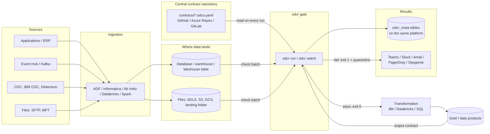
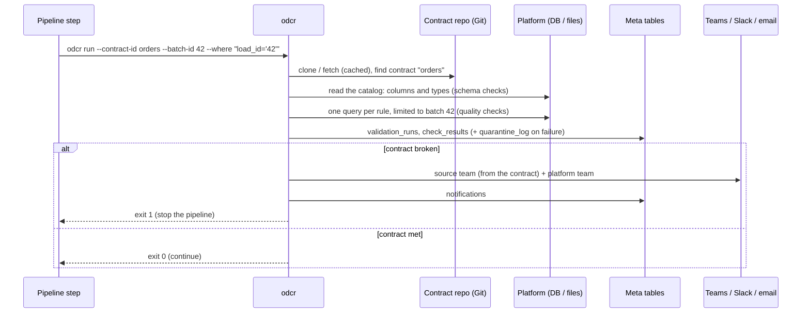

# Architecture and flow

odcr is a command-line tool and Python library. It runs where your pipelines run (a pipeline agent, a
scheduler server, a Databricks job, a container) and connects to the platforms where data lands. There is no
server to operate and no central database to install: results are written to meta tables on your own platforms.

## End to end

1. Producers and consumers agree on a contract in the **contract repository** (pull request, review, CI lint).
2. Data arrives by any route — batch, CDC, stream, file — and **lands** in a table or in files.
3. Right after landing, the pipeline (or `odcr watch`) runs **the gate**: odcr reads the contract from Git and
   checks only that batch on the platform where it landed.
4. **Pass** (exit 0): the pipeline continues to transformation. **Fail** (exit 1): the batch is quarantined, the
   source team and the platform team are notified, and the pipeline stops before bad data spreads.
5. Every run, rule result, alert, reconciliation and stage checkpoint is stored in the **meta tables**.
6. Optionally, the same gate runs on what you publish (gold tables, data products), and `odcr reconcile` /
   `odcr trace` confirm nothing was lost between stages.

## What happens inside `odcr run`

odcr pushes the work down to the platform: each rule is one aggregate query (`COUNT(*) ... WHERE ...`), so no
data leaves the platform and checks scale with the platform, not with the machine running odcr.

## Components

| Component | Where it lives | What it is |
| --- | --- | --- |
| `odcr` CLI / Python package | pipeline agent, scheduler host, container, Databricks cluster | `pip install "odcr[<adapter>]"` |
| Project (`odcr.yaml`) | a Git repository of the data / platform team | connections, meta schema, alerts, where the contracts are |
| Contract repository | GitHub, Azure Repos, GitLab, Bitbucket, or a folder | ODCS YAML, reviewed by producers and consumers |
| Adapters | inside the package | 18 platforms; one small class each |
| Meta tables | `odcr_meta` schema on each platform (or one central platform) | history for audits and dashboards |
| Alert channels | Teams, Slack, email, Google Chat, Discord, PagerDuty, Opsgenie, webhooks | source team + platform team |

## Deployment options

| Option | When |
| --- | --- |
| A step in the ingestion pipeline (Azure DevOps, GitHub Actions, ADF, Airflow, Databricks Workflows) | recommended: the gate sits between ingestion and transformation |
| `odcr watch` as a small service (VM, container, Kubernetes) | data arrives continuously and no pipeline owns the moment of landing |
| Storage event → Function / Lambda → `odcr run --for-object <file>` | files dropped in ADLS / S3 / GCS |
| Scheduler (`odcr watch --once` every N minutes) | simple setups, on-premise schedulers |

See [Running in pipelines](getting-started/pipelines.md) for ready-made Azure DevOps and GitHub Actions
templates, and [Commands](reference/cli.md) for every command.
