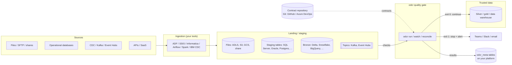
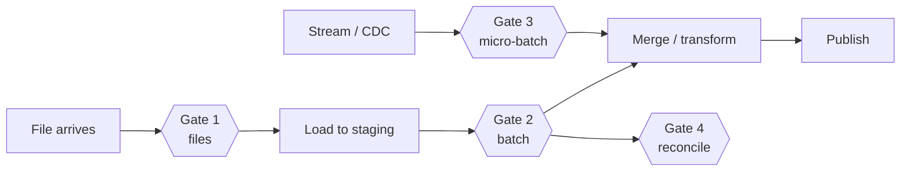
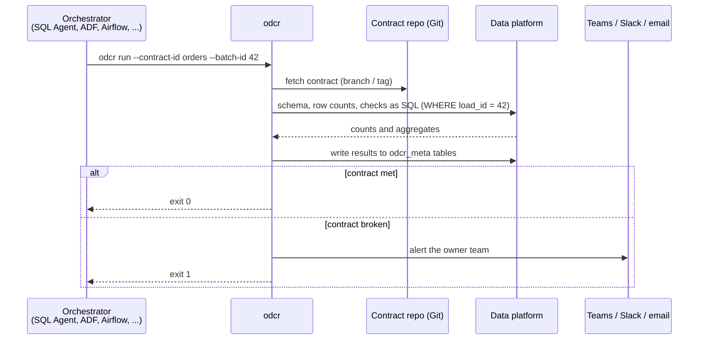
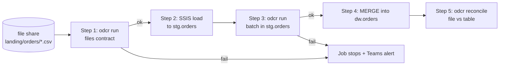
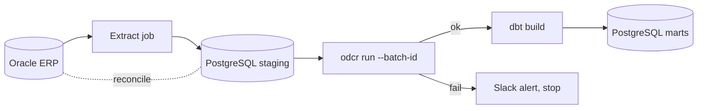
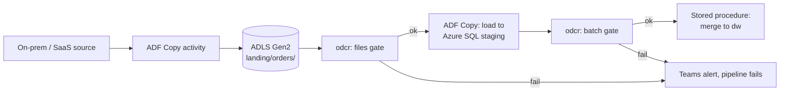
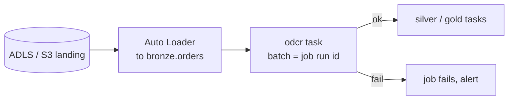
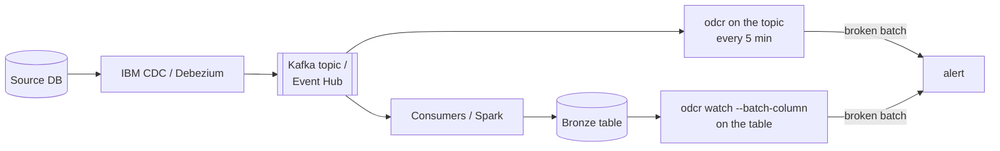
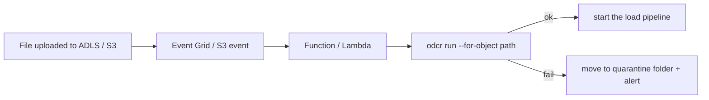

# Where and when odcr runs

odcr does not move data. It is a **quality gate**: a step that your orchestrator runs next to the load. It
connects to where the data landed (files, a table, a topic), checks it against the contract, records the result
in the meta tables and alerts the owners. The exit code decides what happens next:

| Exit code | Meaning | What the pipeline does |
| --- | --- | --- |
| `0` | the batch meets its contract | continue: merge, transform, publish |
| `1` | the batch breaks its contract (or warns, with `--fail-on-warn`) | stop; the batch stays in landing / staging and is logged in `quarantine_log` |

Every orchestrator understands exit codes, so odcr fits SQL Server Agent, Task Scheduler, SSIS, cron, Airflow,
Control-M, Azure Data Factory, Azure DevOps, GitHub Actions, Databricks Workflows and Kubernetes alike.

## The big picture



## When in the flow: four gates

You choose where to put the gates; most pipelines use gate 2, and add the others where they matter.



| Gate | When | What it catches | Command |
| --- | --- | --- | --- |
| **1. Before loading** | the file has landed in ADLS / S3 / a share, before it is loaded | missing or extra columns, wrong types, empty files, bad values — before anything touches the database | `odcr run --contract-id orders_file -C landing` (`files` adapter) |
| **2. After loading, before publishing** (recommended) | the batch is in a staging / bronze table, tagged with a load id | everything in the contract, for exactly this batch | `odcr run --contract-id orders --batch-id <id> --where "load_id = '<id>'"` |
| **3. While loading** | streaming and CDC: every micro-batch, as it arrives | bad messages and batches within minutes, not the next morning | `odcr watch` or `odcr run` on a topic (`kafka`, `eventhubs` adapters) |
| **4. After loading** | source and target both hold the batch | lost or duplicated rows, wrong totals between systems | `odcr reconcile recon.yaml --batch-id <id>` |

!!! tip "Why staging?"
    Loading into a staging table first and publishing only after gate 2 means consumers never see a bad batch.
    If you load straight into the final table, odcr still detects, records and alerts — but cannot stop it.

## What happens inside a run



For databases, the checks run **as SQL inside the database**: the data stays where it is and only counts and
aggregates travel to odcr. For files and topics, odcr reads the batch in its own process (with DuckDB), so run
it close to the storage.

## Scenarios

### 1. Windows server, on-premise: files → SQL Server

A Windows server runs SQL Server Agent (or Task Scheduler). Files arrive on a network share; SSIS loads them
into a staging table. odcr runs as job steps around the load, under the job's Windows account — no password
anywhere.



Install once on the server (or offline from a wheelhouse, see [Installation](../getting-started/installation.md)):

```powershell
py -m pip install odcr-sqlserver odcr-files
odcr init orders_gate --adapter sqlserver
```

```yaml
# odcr.yaml
connections:
  main:                                  # the staging database
    type: sqlserver
    host: sql01.corp.local
    database: staging
    trusted_connection: yes              # Windows authentication: the SQL Agent account / gMSA
  landing:                               # the file share, read in place
    type: files
    storage: local
```

```yaml
# contracts/orders_file.odcs.yaml (excerpt): the files the gate checks
schema:
  - name: orders_file
    physicalName: //fileserver/landing/orders/*.csv
```

SQL Server Agent job steps (type *Operating system (CmdExec)*, or PowerShell with `jobs\ingestion_gate.ps1`):

```bat
odcr run --contract-id orders_file -C landing --batch-id $(ESCAPE_NONE(JOBID))
dtexec /F C:\ssis\load_orders.dtsx /SET \Package.Variables[LoadId].Value;$(ESCAPE_NONE(JOBID))
odcr run --contract-id orders --batch-id $(ESCAPE_NONE(JOBID)) --where "load_id = '$(ESCAPE_NONE(JOBID))'"
sqlcmd -S sql01 -d dw -Q "EXEC dw.merge_orders"
odcr reconcile reconciliations\orders.recon.yaml --batch-id $(ESCAPE_NONE(JOBID))
```

Set *On failure action: Quit the job reporting failure* on each odcr step. With SSIS only, use an
**Execute Process Task** with *FailTaskIfReturnCodeIsNotSuccessValue* on.

### 2. Linux server, on-premise: Oracle → PostgreSQL with cron or Airflow



```bash
pip install odcr-postgres odcr-oracle          # or: docker pull ghcr.io/sulfibashy/odcr
# crontab: every night at 02:00, after the extract
0 2 * * *  cd /opt/odcr/orders_gate && ./jobs/ingestion_gate.sh "$(date +\%F)" && dbt build
```

In Airflow, odcr is one task between extract and transform (see [Airflow](../integrations/airflow.md)):
`extract >> odcr_gate >> dbt_build`. Secrets come from the environment, a mounted secret file or the OS keyring.

### 3. Azure: ADF copies to ADLS, then Azure SQL / Synapse



ADF does not run command lines itself, so odcr runs in one of these, called from the pipeline
(see [Azure Data Factory](../integrations/azure-data-factory.md)):

| Runs odcr | Called by ADF with | Good for |
| --- | --- | --- |
| Azure Function (`odcr-sqlserver` in `requirements.txt`) | Azure Function activity | small, fast checks |
| Azure Container Apps job with `ghcr.io/sulfibashy/odcr` | Web activity (start job) | any size, no Python to maintain |
| Databricks job / notebook | Databricks activity | teams already on Databricks |
| Self-hosted integration runtime VM | Custom activity / script | data behind the firewall |

Authentication is a **managed identity**: `authentication: ActiveDirectoryMsi` for Azure SQL / Synapse / Fabric,
and the identity's Storage Blob Data Reader role for ADLS.

The same flow from an **Azure DevOps** pipeline: a step with `container: ghcr.io/sulfibashy/odcr:0.2.2` running
`odcr run ...` after the load step (see [Running in pipelines](../getting-started/pipelines.md)).

### 4. Databricks lakehouse: Auto Loader → bronze → silver



A Databricks job with three tasks: ingest → `odcr` → transform. The odcr task is a Python wheel or notebook task
with `%pip install odcr-databricks`, or a container task with the image. For Structured Streaming, call odcr from
`foreachBatch` with the `epoch_id` as batch id (see [When data lands](when-data-lands.md)).

### 5. Streaming and CDC: IBM CDC / Debezium → Kafka or Event Hubs



Two complementary checks, both on their own consumer group or batch column, so they never slow the producers:

```bash
odcr run --contract-id orders_events -C events          # kafka / eventhubs: the messages since the last run
odcr watch --contract-id orders --batch-column load_id --interval 300    # the table the stream writes to
```

Run them as a small always-on container (Kubernetes `Deployment`, Container Apps), or as a scheduled job with
`--once`. For Event Hubs, odcr signs in with Entra ID (managed identity) and needs only the *Data Receiver* role.

### 6. Event-driven: a file lands, the check starts



No schedule and no waiting: each file is checked within seconds of arriving.

### 7. AWS and GCP

| Flow | odcr runs in |
| --- | --- |
| S3 → Glue → Redshift | a Glue Python shell job, or a step in Step Functions with an ECS / Fargate task using the image |
| S3 → Athena tables | Lambda (`odcr-athena`), triggered by S3 events or EventBridge |
| GCS → BigQuery | Cloud Run job with the image, or a Cloud Composer (Airflow) task |
| Any → Snowflake | Airflow / dbt Cloud / GitHub Actions step before `dbt build` |

### 8. Kubernetes and containers

```yaml
apiVersion: batch/v1
kind: CronJob
metadata: {name: orders-contract-gate}
spec:
  schedule: "*/15 * * * *"
  jobTemplate:
    spec:
      template:
        spec:
          restartPolicy: Never
          containers:
            - name: odcr
              image: ghcr.io/sulfibashy/odcr:0.2.2
              args: ["odcr", "watch", "--contract-id", "orders", "--batch-column", "load_id", "--once"]
              envFrom: [{secretRef: {name: odcr-connections}}]
              volumeMounts: [{name: project, mountPath: /work}]
          volumes: [{name: project, configMap: {name: odcr-project}}]
```

## Choosing a setup

| Your situation | Run odcr | Trigger |
| --- | --- | --- |
| SQL Server on Windows, SSIS / SQL Agent | on the SQL Server or an app server, `pip install` | job step after the load |
| Linux servers, cron / Control-M / Airflow | on the scheduler host, or the Docker image | task after the load |
| Azure Data Factory | Function, Container Apps job, Databricks or self-hosted IR | activity after the Copy |
| Azure DevOps / GitHub Actions pipelines | the pipeline agent, or `container: ghcr.io/sulfibashy/odcr` | step after the load |
| Databricks | a task in the same job | between ingest and transform tasks |
| Streaming / CDC | always-on container or scheduled `--once` | `odcr watch`, or `odcr run` on the topic |
| Files dropped at random times | Function / Lambda | storage event |
| Developer laptop (Windows, macOS, Linux) | `pip install` | by hand, while writing contracts |

## Good to know

- **Network:** odcr needs to reach the data platform, the contract repository (or a local copy of it) and the
  notification endpoints. Run it inside the same network as the data; nothing is exposed.
- **Credentials:** Windows authentication, Kerberos, managed identities, workload identity and OS keyrings are
  all supported — see [Security](../security.md). No passwords in files.
- **Same results everywhere:** wherever odcr runs, results go to the `odcr_meta` tables on your platform, so
  `odcr history` and `odcr trace` show every run from every scheduler in one place.
- **Cost:** checks run as SQL in the database, filtered to the batch; there is no extra compute cluster.
